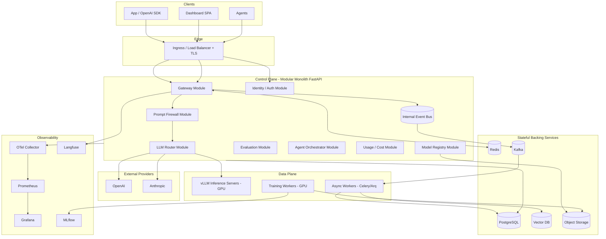
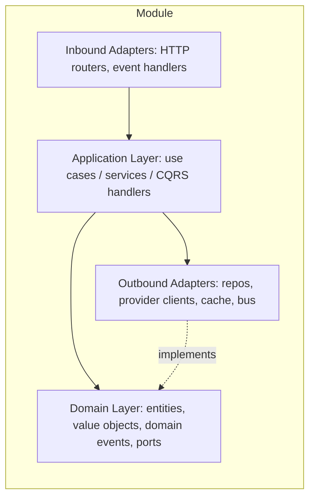
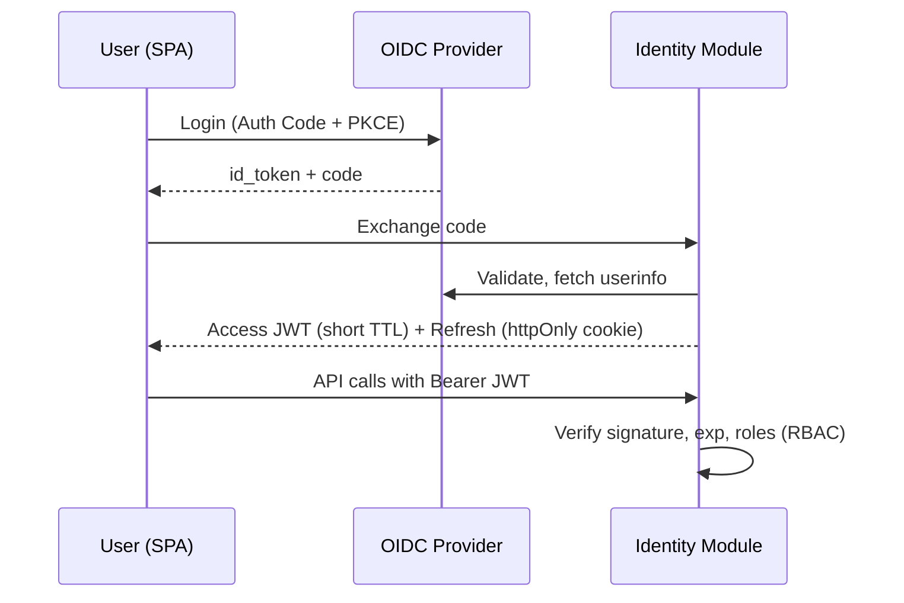

# SecurAI — Part 2: Architecture

> SAD Sections 7–11 — High‑Level Architecture, Low‑Level Architecture, Service Breakdown, API Gateway Design, Authentication Flow.

---

## 7. High‑Level Architecture

SecurAI is a **microservice‑ready modular monolith** for the control plane, with **separately deployed data‑plane workers** (inference, training, async jobs) because their resource and scaling profiles differ.



### 7.1 Planes

- **Control plane** (stateless, CPU): the FastAPI modular monolith. Owns auth, gateway, firewall, routing decisions, registry, evaluation orchestration, agents orchestration, billing. Scales horizontally.
- **Data plane** (stateful/GPU): vLLM inference servers, training workers, async workers. Scaled independently (GPU node pools, KEDA/queue‑based autoscaling).
- **Backing services**: PostgreSQL (system of record), Redis (cache/rate‑limit/locks), Kafka (durable event backbone), Vector DB (semantic cache + RAG + eval embeddings), Object storage (artifacts/datasets/reports).
- **Observability plane**: Prometheus/Grafana, OpenTelemetry Collector, Langfuse, MLflow.

### 7.2 Why modular monolith (not microservices first)

| Concern | Modular monolith choice |
|---|---|
| Single‑engineer build | One deployable, one CI, shared libs → fast iteration. |
| Latency | In‑process calls between gateway↔firewall↔router avoid network hops. |
| Transactions | Control data changes are local PG transactions. |
| Future extraction | Module boundaries + ports + event bus make extraction mechanical. |

GPU/inference and training are *already* split out because co‑locating them with the request path would couple unrelated scaling and failure domains.

---

## 8. Low‑Level Architecture

Each module follows **Hexagonal (Ports & Adapters) + Clean Architecture** layering:



### 8.1 Layer rules

1. **Domain** has no framework/IO imports. Pure Python: entities, value objects, domain services, and **ports** (abstract interfaces).
2. **Application** orchestrates use cases (commands/queries), depends only on domain ports; emits domain events.
3. **Adapters** implement ports: PostgreSQL repositories, Redis cache, provider HTTP clients, Kafka producer/consumer, vector DB client.
4. **Composition root** (DI container) wires adapters→ports at startup.
5. **Dependency direction** always points inward; enforced by import‑linter in CI.

### 8.2 Cross‑cutting concerns

- **Dependency Injection** via a lightweight container (e.g. `dependency‑injector` or manual provider functions) — keeps modules testable with in‑memory adapters.
- **CQRS** where it pays off: heavy **read** paths (analytics, dashboards) use denormalized read models populated from events; **write** paths use domain aggregates. Simple modules stay CRUD.
- **Event‑driven**: domain events → internal bus → Kafka for durable fan‑out (analytics, audit, billing, eval triggers).
- **Repository pattern** abstracts persistence; one repo per aggregate root.
- **Idempotency & outbox**: the **transactional outbox** pattern guarantees event publication consistency with DB writes.

### 8.3 Request concurrency model

- FastAPI + `async` IO for provider/network calls.
- CPU‑heavy guardrail models run in a worker pool / dedicated detector service to avoid blocking the event loop.
- Inference and training never run in the control‑plane process.

---

## 9. Service Breakdown

Modules inside the monolith (each = a bounded context = future microservice):

| Module | Responsibility | Owns tables | Key ports (outbound) | Future service |
|---|---|---|---|---|
| **identity** | Orgs, users, projects, API keys, RBAC, OIDC. | orgs, users, projects, api_keys, roles | UserRepo, KeyRepo, TokenIssuer | `identity-svc` |
| **gateway** | Request intake, validation, streaming, caching, idempotency, logging. | request_logs (write‑through) | Cache, Router, Firewall, Bus | `gateway-svc` |
| **firewall** | Inbound/outbound guardrails, policy engine, audit. | policies, security_events | Detectors, PolicyRepo, AuditSink | `firewall-svc` |
| **router** | Backend registry, routing strategies, fallback, health, circuit breaking. | backends, route_policies | ProviderClient, HealthProbe, Metrics | `router-svc` |
| **registry** | Models, versions, lineage, artifacts, stages. | models, model_versions, artifacts, lineage | ArtifactStore, RegistryRepo | `registry-svc` |
| **finetune** | Dataset curation, training job orchestration. | datasets, train_jobs | JobQueue, ArtifactStore, MLflowClient | `finetune-svc` |
| **evaluation** | Benchmarks, metrics, A/B, feedback. | eval_runs, eval_results, feedback, ab_tests | DatasetStore, Scorers, RegistryRepo | `eval-svc` |
| **observability** | Metric/trace export, Langfuse bridge, alert rules. | (stateless) | OTel, Langfuse, Prometheus | shared lib |
| **agents** | Agent runtime, tools, memory, orchestration. | agents, agent_runs, agent_steps | GatewayClient, ToolRegistry, MemoryStore | `agents-svc` |
| **billing/usage** | Token & cost accounting, quotas, reports. | usage_events, invoices | UsageRepo, PricingTable | `usage-svc` |
| **admin/dashboard‑api** | Read models / BFF for the SPA. | read‑model views | all read repos | BFF |

### 9.1 Separately deployed services (not in monolith)

- **vLLM inference servers** — one deployment per served model/adapter group (GPU).
- **Training workers** — ephemeral GPU jobs (K8s Jobs / queue‑driven).
- **Async worker pool** — Celery/Arq consuming Kafka for evals, analytics rollups, audit persistence, webhook delivery.

---

## 10. API Gateway Design

### 10.1 Surface

- **Inference API (OpenAI‑compatible):** `/v1/chat/completions`, `/v1/completions`, `/v1/embeddings`, `/v1/models`.
- **Management API:** `/api/v1/orgs`, `/projects`, `/keys`, `/backends`, `/policies`, `/models`, `/evals`, `/agents`, `/usage`.
- **Feedback API:** `/api/v1/feedback`.
- **Health:** `/healthz` (liveness), `/readyz` (readiness), `/metrics` (Prometheus).

### 10.2 Middleware pipeline (ordered)

```mermaid
flowchart LR
  A[TLS termination - ingress] --> B[Request ID / correlation]
  B --> C[Auth - API key / JWT]
  C --> D[Org/Project resolution + RBAC]
  D --> E[Rate limit + quota - Redis]
  E --> F[Schema validation / normalization]
  F --> G[Idempotency check]
  G --> H[Inbound Firewall]
  H --> I[Cache lookup]
  I -->|hit| R[Return cached]
  I -->|miss| J[Router -> backend]
  J --> K[Stream / collect]
  K --> L[Outbound Firewall]
  L --> M[Usage + cost accounting]
  M --> N[Async: log/trace/audit via event]
  N --> R2[Response]
```



### 10.3 Design decisions

- **OpenAI compatibility** maximizes adoption (drop‑in base URL). Internally requests are mapped to a **provider‑agnostic canonical schema**.
- **Streaming**: SSE pass‑through; outbound firewall runs in **streaming‑safe mode** (chunk buffering for detectors that need windows; PII masking on token windows; hard‑stop on policy violation).
- **Caching**: two‑tier — exact (hash of normalized request) and **semantic** (embedding similarity in vector DB) with configurable threshold and TTL; never cache when temperature/randomness or `no‑store` set.
- **Rate limiting**: Redis token‑bucket per key + per project; sliding window for quotas; `429 + Retry‑After`.
- **Idempotency**: client `Idempotency‑Key` header stored in Redis with response snapshot.
- **Backpressure**: concurrency limits + queue with shed‑load (`503`) when saturated.
- **Logging**: async, redacted, correlation‑ID stamped; full prompt/response stored only per project retention policy.

---

## 11. Authentication Flow

### 11.1 Two auth surfaces

1. **Programmatic (inference/management API):** API keys.
2. **Human (dashboard):** OIDC → short‑lived JWT access token + refresh; SSO‑ready.

### 11.2 API key flow

```mermaid
sequenceDiagram
  participant C as Client
  participant GW as Gateway
  participant R as Redis
  participant DB as PostgreSQL
  C->>GW: Request + Authorization: Bearer sk_live_...
  GW->>GW: Extract key id prefix; compute hash
  GW->>R: Lookup cached key meta (hash)
  alt cache miss
    GW->>DB: SELECT api_key WHERE hash=...
    DB-->>GW: key (org, project, scopes, status)
    GW->>R: cache meta (short TTL)
  end
  GW->>GW: Validate status/scope/expiry
  alt invalid
    GW-->>C: 401 / 403
  else valid
    GW->>GW: Attach principal (org, project, scopes)
    GW->>GW: Continue pipeline
  end
```

- Keys are **shown once**, stored as `Argon2id`/`bcrypt` hash + non‑secret prefix for lookup. Revocation flips status; Redis TTL bounds staleness.
- Scopes encode allowed actions (`inference:write`, `registry:read`, etc.) and project binding → enforced by RBAC.

### 11.3 Dashboard (OIDC/JWT) flow



### 11.4 RBAC model

- **Roles:** `org_admin`, `project_admin`, `developer`, `security_admin`, `viewer`, `billing_admin`.
- **Scope:** role assignments are scoped to org and optionally project.
- **Enforcement:** decorator/dependency on each route checks `(principal, action, resource)`; decisions are cache‑friendly and audited for sensitive actions.
- **Multi‑tenancy isolation:** every query is org‑scoped (row‑level via mandatory `org_id` filter; optional PG RLS for defense in depth).

---

*Continue to [Part 3 — Data & Flows](./03-data-and-flows.md).*
