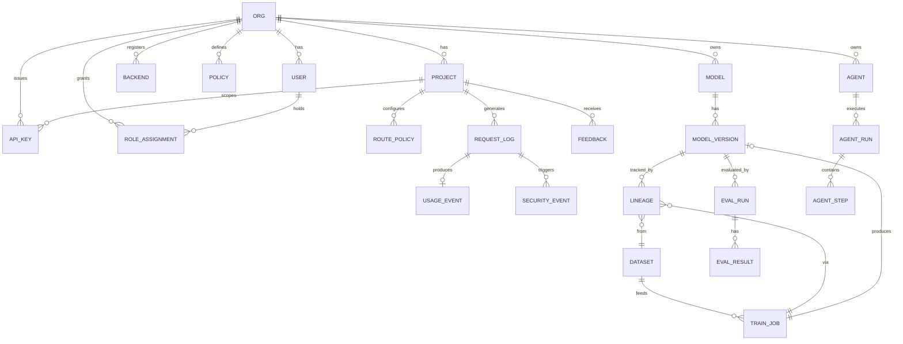
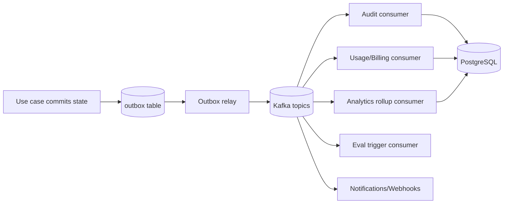
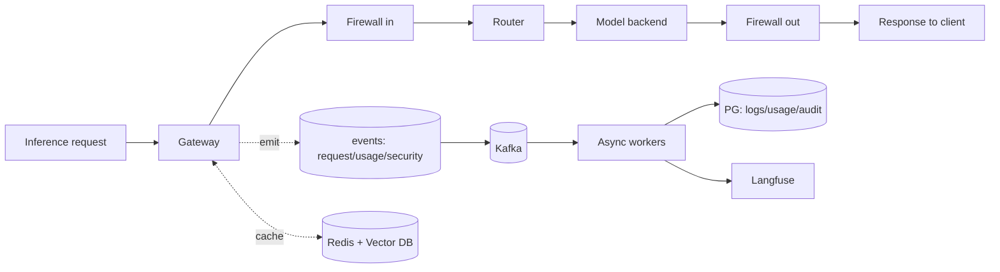
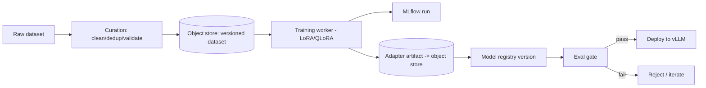
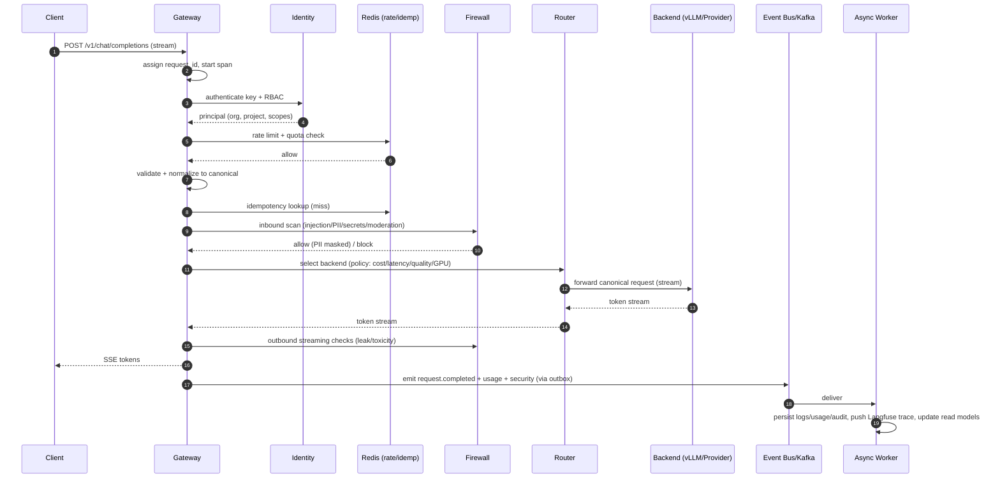

# SecurAI — Part 3: Data & Flows

> SAD Sections 12–17 — Database Design, ER Diagram, Service Communication, Event Flow, Data Flow, Request Lifecycle.

---

## 12. Database Design

### 12.1 Storage strategy

| Store | Purpose | Rationale |
|---|---|---|
| **PostgreSQL** | System of record: identity, registry, policies, usage, eval metadata, audit. | ACID, relational integrity, JSONB for flexible metadata. |
| **Redis** | Cache, rate limits, idempotency, locks, ephemeral state. | Sub‑ms latency. |
| **Kafka** | Durable event log (analytics, audit, billing, eval triggers). | Replayable, decoupled fan‑out. |
| **Vector DB** (pgvector / Qdrant) | Semantic cache, RAG, eval embeddings. | ANN search. |
| **Object storage** (S3/GCS/Azure Blob) | Datasets, adapters/artifacts, eval reports, large logs. | Cheap, durable (11 9's). |
| **Time‑series** (Prometheus) | Operational metrics. | Built for metrics. |

### 12.2 Conventions

- UUIDv7 primary keys (time‑sortable). Every tenant‑scoped table has non‑null `org_id`.
- `created_at`/`updated_at` timestamps; soft delete via `deleted_at` where needed.
- Money stored as integer micro‑USD; tokens as integers.
- Flexible metadata in `JSONB`; hot query fields promoted to columns + indexes.
- Schema migrations via **Alembic**; forward‑only, reviewed.
- **Append‑only** tables for `security_events` and `usage_events` (immutability / audit).
- **Partitioning** by month on high‑volume `request_logs` and `usage_events`.

### 12.3 Key tables (abridged)

- `orgs(id, name, plan, created_at)`
- `users(id, org_id, email, status, created_at)`
- `projects(id, org_id, name, settings_jsonb)`
- `api_keys(id, org_id, project_id, prefix, hash, scopes, status, expires_at, last_used_at)`
- `roles` / `role_assignments(principal_id, role, org_id, project_id)`
- `backends(id, org_id, type, model, endpoint, cost_per_1k_in, cost_per_1k_out, capabilities_jsonb, health)`
- `route_policies(id, project_id, strategy, weights_jsonb, fallback_chain)`
- `policies(id, org_id, scope, rules_jsonb, mode, version)`
- `security_events(id, org_id, project_id, request_id, type, severity, decision, detail_jsonb, created_at)` *(append‑only, partitioned)*
- `request_logs(id, org_id, project_id, request_id, model, route, status, latency_ms, tokens_in, tokens_out, cached, created_at)` *(partitioned)*
- `usage_events(id, org_id, project_id, request_id, model, tokens_in, tokens_out, cost_micro_usd, created_at)` *(append‑only, partitioned)*
- `models(id, org_id, name, task, base_model)`
- `model_versions(id, model_id, version, stage, metrics_jsonb, artifact_uri, created_at)`
- `lineage(id, model_version_id, dataset_id, train_job_id, parent_version_id)`
- `datasets(id, org_id, name, uri, stats_jsonb, validation_jsonb)`
- `train_jobs(id, org_id, dataset_id, base_model, method, hyperparams_jsonb, status, mlflow_run_id)`
- `eval_runs(id, org_id, target_jsonb, dataset_id, status)` / `eval_results(id, eval_run_id, metric, value, detail_jsonb)`
- `feedback(id, org_id, project_id, request_id, rating, comment, labels_jsonb)`
- `ab_tests(id, project_id, variants_jsonb, allocation_jsonb, status)`
- `agents(id, org_id, type, config_jsonb)` / `agent_runs(id, agent_id, status)` / `agent_steps(id, run_id, step_no, action_jsonb, trace_id)`
- `outbox(id, aggregate, event_type, payload_jsonb, published_at)`

---

## 13. ER Diagram

---

## 14. Service Communication

### 14.1 Communication styles

| Interaction | Style | Protocol |
|---|---|---|
| Client → Gateway | Sync request/response, streaming | HTTPS / SSE |
| Gateway → Router → Backend | Sync | HTTP(S) to vLLM / provider APIs |
| Module → Module (in‑monolith) | In‑process function calls via ports | Python |
| Control plane → Async workers | Async, durable | Kafka topics |
| Control plane ↔ Redis | Sync | RESP |
| Workers → PostgreSQL/Object store | Sync | SQL / S3 API |
| Internal → Observability | Fire‑and‑forget | OTLP / Prometheus scrape |

### 14.2 Contracts

- **In‑process** boundaries are typed Python **ports** (Protocols/ABCs) — same contracts that become network APIs on extraction.
- **External** APIs versioned under `/v1` and `/api/v1`; OpenAPI generated from FastAPI/Pydantic.
- **Event** contracts are versioned, schema‑validated (Pydantic/JSON Schema, registry‑ready), and backward‑compatible.
- **Resilience:** timeouts, retries w/ jittered backoff, circuit breakers per backend, bulkheads (separate connection pools), dead‑letter topics for poison events.

### 14.3 Extraction path

When a module becomes a microservice, its outbound ports get **HTTP/gRPC adapters** and its event handlers subscribe to the same Kafka topics — no changes to application/domain layers.

---

## 15. Event Flow

### 15.1 Event backbone

Domain events are written to a transactional **outbox** in the same DB transaction as state changes, then a relay publishes them to **Kafka**. Consumers are idempotent.

### 15.2 Core topics & events

| Topic | Events | Consumers |
|---|---|---|
| `requests` | `request.completed`, `request.failed` | analytics, usage, langfuse bridge |
| `security` | `firewall.flagged`, `firewall.blocked`, `pii.masked` | audit, notifications, dashboard |
| `usage` | `tokens.recorded`, `cost.accrued` | billing, quotas |
| `registry` | `model.registered`, `version.promoted`, `version.archived` | deploy hooks, dashboard |
| `training` | `job.queued/started/succeeded/failed` | mlflow bridge, notifications |
| `evaluation` | `eval.requested/completed` | registry gate, dashboard |
| `agents` | `agent.step`, `agent.completed/failed` | tracing, dashboard |

### 15.3 Delivery guarantees

- **At‑least‑once** delivery; consumers are **idempotent** (dedupe by event id).
- Ordering preserved per key (e.g., per request id) via Kafka partitioning.
- Failed events → **DLQ** with replay tooling.

---

## 16. Data Flow

### 16.1 Inference data flow (write path → analytics)

### 16.2 Training/registry data flow

### 16.3 Data classification & retention

| Data class | Examples | Default retention | Controls |
|---|---|---|---|
| Sensitive content | prompts/responses | Per‑project (e.g. 30 days) | redaction, encryption, opt‑out |
| Operational | latency/error metrics | 13 months | aggregated |
| Audit/security | firewall decisions | ≥ 1 year (append‑only) | immutable, tamper‑evident |
| Artifacts | datasets, adapters | until archived | versioned, access‑controlled |

---

## 17. Request Lifecycle

End‑to‑end lifecycle of a single chat completion (cache miss, streaming):

### 17.1 Failure & degradation in the lifecycle

- **Auth fail** → 401/403, audited.
- **Rate/quota** → 429 with `Retry‑After`.
- **Firewall block** → 4xx policy response + `security.blocked` event.
- **Backend error/timeout** → router retries next in fallback chain; circuit opens on repeated failure; if all fail → 502 with structured error.
- **Outbound leak detected mid‑stream** → stream terminated, partial redacted, incident raised.
- **Event publish** is guaranteed by outbox; user response never blocks on Kafka.

---

*Continue to [Part 4 — Structure & Modules](./04-structure-and-modules.md).*
