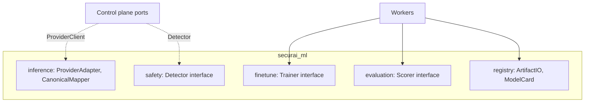

# SecurAI — Part 4: Structure & Modules

> SAD Sections 18–21 — Folder Structure, Backend Architecture, Frontend Architecture, AI Module Architecture.

---

## 18. Folder Structure

Monorepo with a clear split between the control‑plane app, AI/ML workers, frontend, infra, and docs.

```text
securai/
├── apps/
│   ├── api/                         # FastAPI modular monolith (control plane)
│   │   ├── src/securai/
│   │   │   ├── main.py              # app factory, lifespan, router mounting
│   │   │   ├── container.py         # DI composition root
│   │   │   ├── config/              # settings (pydantic-settings), feature flags
│   │   │   ├── shared/              # cross-cutting: errors, logging, otel, ids, outbox
│   │   │   ├── modules/
│   │   │   │   ├── identity/
│   │   │   │   │   ├── domain/       # entities, value objects, ports, events
│   │   │   │   │   ├── application/  # use cases (commands/queries), services
│   │   │   │   │   ├── adapters/     # repos (sqlalchemy), oidc client, hashers
│   │   │   │   │   └── api/          # routers, schemas (pydantic), deps
│   │   │   │   ├── gateway/
│   │   │   │   ├── firewall/
│   │   │   │   ├── router/
│   │   │   │   ├── registry/
│   │   │   │   ├── finetune/
│   │   │   │   ├── evaluation/
│   │   │   │   ├── agents/
│   │   │   │   ├── billing/
│   │   │   │   └── observability/
│   │   │   └── interfaces/           # http app, event consumers, cli
│   │   ├── tests/                    # unit / integration / contract / e2e
│   │   ├── alembic/                  # migrations
│   │   └── pyproject.toml
│   │
│   ├── workers/                      # async workers (Kafka consumers, Celery/Arq)
│   │   └── src/securai_workers/      # audit, usage rollup, eval runner, webhooks
│   │
│   └── web/                          # frontend SPA (React + TS)
│       ├── src/
│       │   ├── app/                  # routing, providers
│       │   ├── features/             # feature-sliced: projects, keys, models, security...
│       │   ├── entities/             # domain models, api clients (generated)
│       │   ├── shared/               # ui kit, hooks, lib
│       │   └── pages/
│       └── package.json
│
├── ml/                               # AI/ML package (importable + worker entrypoints)
│   └── src/securai_ml/
│       ├── inference/                # vLLM server config, adapters, canonical mappers
│       ├── finetune/                 # data curation, LoRA/QLoRA trainers, configs
│       ├── evaluation/               # scorers (hallucination, faithfulness, etc.)
│       ├── safety/                   # detectors (injection, jailbreak, pii, secrets, moderation)
│       └── registry/                 # artifact io, model cards
│
├── packages/                         # shared libs (contracts, sdk, telemetry)
│   ├── contracts/                    # event & API schemas (single source of truth)
│   └── client-sdk/                   # python/ts client
│
├── deploy/
│   ├── docker/                       # Dockerfiles
│   ├── compose/                      # docker-compose.*.yml
│   ├── helm/securai/                 # Helm chart (control plane, workers, vllm)
│   ├── k8s/                          # raw manifests / kustomize bases+overlays
│   └── terraform/                    # cloud infra modules (eks/gke/aks, pg, redis, s3)
│
├── .github/workflows/                # CI/CD pipelines
├── docs/architecture/                # this SAD
├── Makefile                          # dev tasks
└── README.md
```

### 18.1 Module internal structure (repeated per bounded context)

Every module mirrors the hexagonal layering: `domain/` (pure), `application/` (use cases), `adapters/` (IO), `api/` (HTTP + schemas). This uniformity is what makes extraction mechanical and onboarding fast.

---

## 19. Backend Architecture

### 19.1 Stack

- **Language/runtime:** Python 3.12, `asyncio`.
- **Web:** FastAPI + Uvicorn/Gunicorn workers; Pydantic v2 for validation.
- **Persistence:** SQLAlchemy 2.0 (async) + Alembic; `asyncpg` driver.
- **Cache/queues:** `redis-py`; Kafka via `aiokafka`/`confluent-kafka`.
- **DI:** `dependency-injector` (or explicit provider functions) — composition root in `container.py`.
- **Background:** Celery or Arq workers (Kafka‑triggered + scheduled).
- **Telemetry:** OpenTelemetry SDK, `prometheus-client`, structured logging (`structlog`).

### 19.2 Application patterns

- **Use cases / CQRS:** Commands mutate aggregates inside a unit‑of‑work transaction; Queries hit read models/repositories. A thin **mediator** dispatches command/query objects to handlers.
- **Unit of Work + Outbox:** repositories enroll in a UoW; on commit, domain events are written to `outbox` atomically.
- **Ports & Adapters:** domain defines `XxxRepo`, `Cache?`, `ProviderClient`, `EventPublisher` Protocols; adapters implement them.
- **Error model:** typed domain errors → mapped to RFC 9457 (`application/problem+json`) responses at the API edge.
- **Configuration:** 12‑factor via env + `pydantic-settings`; secrets from vault/secret manager, never in code.
- **Feature flags:** per‑org/project flags to ship phases progressively.

### 19.3 Cross‑cutting middleware

Correlation IDs, auth, RBAC, rate limiting, request/response logging (redacted), exception handling, OTel span creation, Prometheus metrics — all as ordered ASGI middleware/dependencies (see Part 2 §10.2).

### 19.4 Concurrency & isolation

- Async IO for network‑bound work; **bounded thread/process pools** for CPU‑bound detectors; never block the event loop.
- Per‑backend connection pools (bulkheads) prevent one slow provider from starving others.
- Graceful shutdown drains in‑flight requests; readiness probe gates traffic.

---

## 20. Frontend Architecture

### 20.1 Stack

- **React 18 + TypeScript**, **Vite** build.
- **State/data:** TanStack Query (server state) + Zustand (local UI state).
- **UI:** Tailwind CSS + a component library (shadcn/ui / Radix).
- **Charts:** Recharts/visx for cost/latency/token analytics.
- **Auth:** OIDC Auth Code + PKCE; access JWT in memory, refresh in httpOnly cookie.
- **API types:** generated from backend OpenAPI (`openapi-typescript`) → end‑to‑end type safety.

### 20.2 Structure (Feature‑Sliced Design)

```text
features/  → dashboard, projects, api-keys, models, deployments,
             routing, security-incidents, evaluations, costs, agents, settings
entities/  → typed domain models + generated API clients
shared/    → ui kit, hooks, formatting, auth, error boundary
app/       → routing, providers, layout, theming
```

### 20.3 Key screens

- **Overview:** requests, latency, error rate, cost, security incidents (real‑time).
- **Projects & Keys:** CRUD, scopes, rotation, quotas.
- **Models & Deployments:** registry versions, stages, vLLM backends, health.
- **Routing:** strategy config, fallback chains, A/B/canary.
- **Security console:** firewall decisions feed, policy editor, audit search.
- **Evaluations:** run results, A/B comparisons, leaderboards, feedback.
- **Costs/FinOps:** breakdowns by project/model/time, export.
- **Agents:** runs, step traces, budgets.

### 20.4 UX principles

Streaming‑first (live token previews where relevant), optimistic updates with rollback, accessible (WCAG AA), dark mode, empty/loading/error states everywhere, and deep links to traces.

---

## 21. AI Module Architecture

The `securai_ml` package isolates all model/ML logic behind clean interfaces so the control plane never imports heavy ML deps directly (they live in workers/inference servers).

### 21.1 Sub‑modules & interfaces



- **ProviderAdapter** (`generate`, `stream`, `embed`, `health`, `cost_estimate`): implemented for `vLLM`, `OpenAI`, `Anthropic`; new providers = new adapter only.
- **Detector** (`scan(text, context) -> Findings`): injection, jailbreak, PII, secrets, moderation. Each declares latency class (fast/heavy) and runs sync or async/sampled accordingly.
- **Trainer** (`prepare`, `train`, `save_adapter`): LoRA/QLoRA via PEFT + Transformers; emits MLflow metrics.
- **Scorer** (`score(samples) -> Metrics`): latency, accuracy, hallucination, faithfulness, context precision/recall, toxicity.
- **ArtifactIO**: read/write adapters/datasets/reports to object storage; produces model cards.

### 21.2 Inference engine choices

- **vLLM** for self‑hosted models (continuous batching, PagedAttention, OpenAI‑compatible server) → high GPU throughput.
- **LoRA adapters** can be hot‑swapped/served by vLLM, enabling many fine‑tunes per base model on shared GPUs.
- Canonical schema decouples the gateway from any single provider's request format.

### 21.3 Safety model strategy

- **Layered detectors:** cheap regex/heuristics + classifier models (e.g. small transformer classifiers) + optional LLM‑as‑judge for ambiguous cases.
- **Fast path** (regex/PII/secret patterns, deny‑lists) within the latency budget (<30 ms); **heavy path** (LLM judge) async or on sampled traffic, can downgrade severity post‑hoc and raise incidents.
- Detectors are **versioned and independently deployable**, and their decisions are explainable (which rule/score triggered).

### 21.4 Dependency isolation

Control plane depends only on **interfaces** (ports). Heavy libs (`torch`, `transformers`, `peft`, `vllm`) are installed only in worker/inference images, keeping the API image small and fast to scale.

---

*Continue to [Part 5 — AI Pipelines](./05-ai-pipelines.md).*
