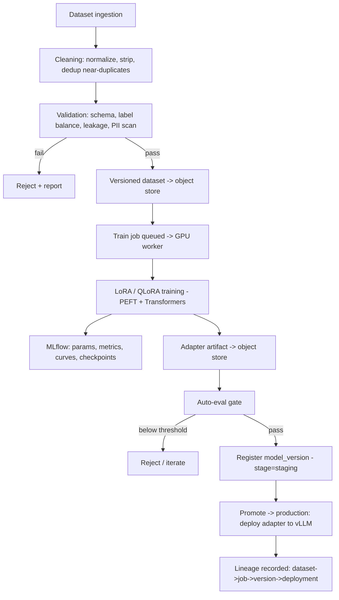
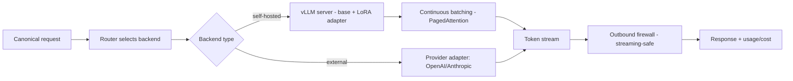
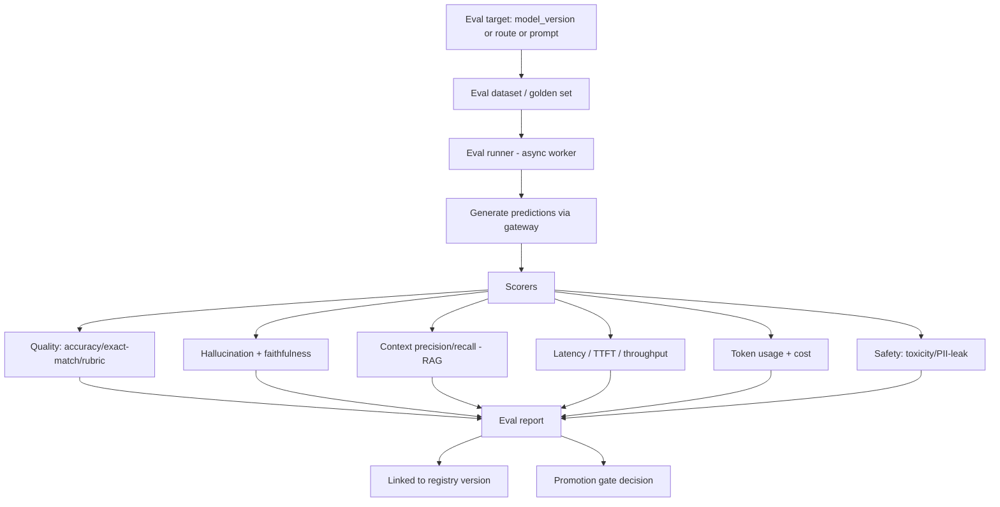

# SecurAI — Part 5: AI Pipelines

> SAD Sections 22–24 — Training Pipeline, Inference Pipeline, Evaluation Pipeline.

---

## 22. Training Pipeline (Fine‑Tuning)

End‑to‑end lifecycle from raw data to a deployable, evaluated, registered model version.

### 22.1 Dataset curation

- **Ingestion:** JSONL/CSV/parquet from object store or upload; schema declared per task (chat, instruction, classification).
- **Cleaning:** unicode normalization, whitespace/HTML stripping, language filtering, **exact + near‑duplicate dedup** (MinHash/embedding similarity).
- **Validation:** schema conformance, label balance, train/val/test split integrity, **leakage detection** (no test rows in train), **PII/secret scan** (reuse firewall detectors), toxicity sampling. Produces a **validation report** stored with the dataset version.

### 22.2 Training methods

| Method | When | Notes |
|---|---|---|
| **LoRA** | General adaptation when GPU memory is sufficient. | Trains low‑rank adapters; base frozen. |
| **QLoRA** | Large bases / constrained GPU. | 4‑bit NF4 quantized base + LoRA adapters → big memory savings. |

- Built on **PyTorch + Transformers + PEFT + bitsandbytes**; configs declarative (base model, rank, alpha, dropout, target modules, lr, scheduler, epochs, seq len, batch/grad‑accum).
- **Reproducibility:** pinned seeds, env, dataset version, and config captured in MLflow.
- **Resource control:** jobs run as K8s GPU Jobs with limits, checkpointing, and resumability; spot‑friendly via checkpoint resume.

### 22.3 Promotion gate

A model version cannot reach `production` unless it **passes the evaluation gate** (§24) on required metrics (e.g., accuracy ≥ baseline, hallucination ≤ threshold, no safety regressions) and a human approval for sensitive use cases. Promotion deploys the adapter to a vLLM backend and records full lineage.

---

## 23. Inference Pipeline

### 23.1 Serving design

- **vLLM** OpenAI‑compatible servers per model family; **continuous batching** maximizes GPU throughput; **PagedAttention** for memory efficiency.
- **Multi‑LoRA serving:** many adapters on one base model on shared GPUs → cost‑efficient fine‑tune hosting.
- **Quantization** (AWQ/GPTQ/FP8) options per deployment to fit memory/latency targets.
- **Autoscaling:** GPU pods scale on queue depth / GPU utilization (KEDA); scale‑to‑zero for rarely used models where acceptable.

### 23.2 Optimization levers

| Lever | Effect |
|---|---|
| Continuous batching | Higher throughput, better GPU utilization. |
| KV‑cache / prefix caching | Lower latency for shared prefixes (system prompts). |
| Semantic + exact response cache | Avoids inference entirely for repeats. |
| Speculative decoding (optional) | Lower latency for some models. |
| Quantization | Fit bigger models / more replicas per GPU. |
| Streaming | Lower perceived latency (TTFT). |

### 23.3 Reliability

Health checks per backend, circuit breakers, retries with fallback chains, request hedging (optional) for tail‑latency reduction, and graceful draining on model redeploys (blue/green of vLLM deployments).

---

## 24. Evaluation Pipeline

### 24.1 Metric definitions

| Metric | Method |
|---|---|
| **Accuracy / task quality** | Exact match, F1, or **LLM‑as‑judge** with rubric for open‑ended tasks. |
| **Hallucination** | Claim verification against provided context/sources; flag unsupported claims. |
| **Faithfulness** | Proportion of answer claims grounded in retrieved context. |
| **Context precision/recall** | Relevance of retrieved chunks vs. ground truth (RAG). |
| **Latency** | TTFT, total latency, tokens/sec — measured live. |
| **Token usage / cost** | Counted per run, aggregated and priced. |
| **Safety** | Toxicity score, PII‑leak detection, jailbreak‑resilience suite. |

Frameworks: integrate **Ragas**‑style metrics + custom scorers; LLM‑judge calls route through the gateway (so judges are observable and budgeted).

### 24.2 A/B testing & human feedback

- **A/B testing:** define variants (model/prompt/route), allocation %, and success metric; traffic split at the router; statistical significance computed on outcomes (quality, cost, latency, feedback).
- **Human feedback:** thumbs/ratings/annotations via Feedback API, joined to traces and used for regression detection and preference datasets (feeding future fine‑tunes).
- **Online vs offline:** offline benchmarks gate promotion; online A/B + feedback validate in production.

### 24.3 Continuous evaluation

Scheduled evals + drift detection (input distribution, quality regression) trigger alerts and can auto‑open incidents; eval reports are immutable and version‑linked for auditability.

---

*Continue to [Part 6 — Deployment & Platform](./06-deployment-and-platform.md).*
