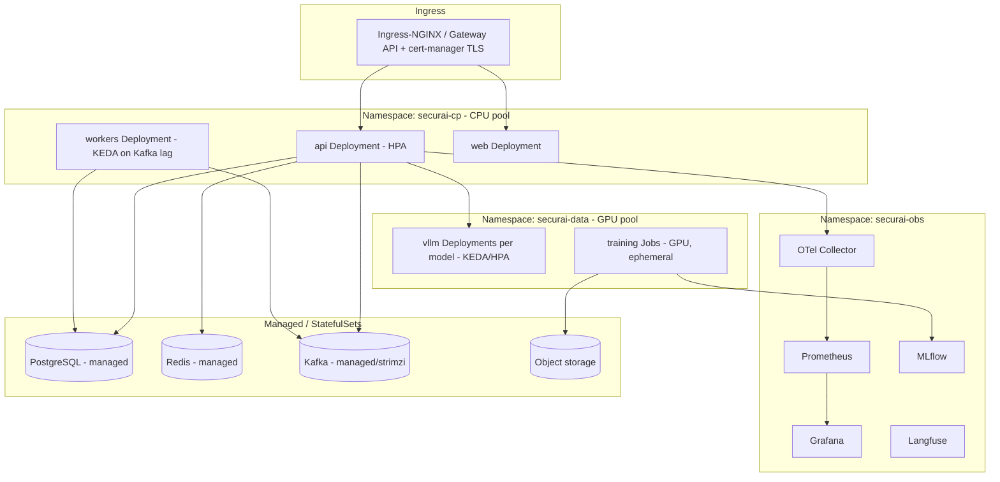
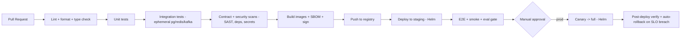
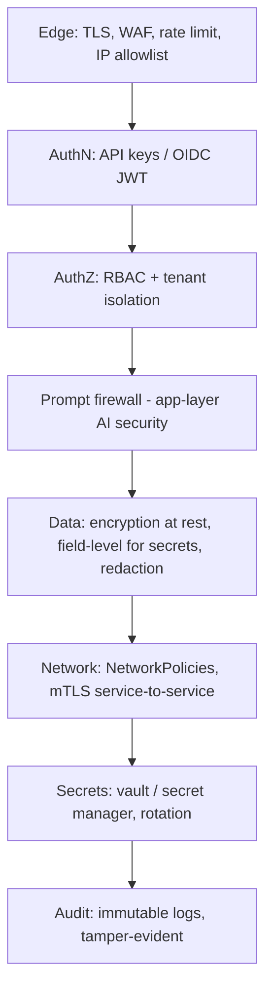
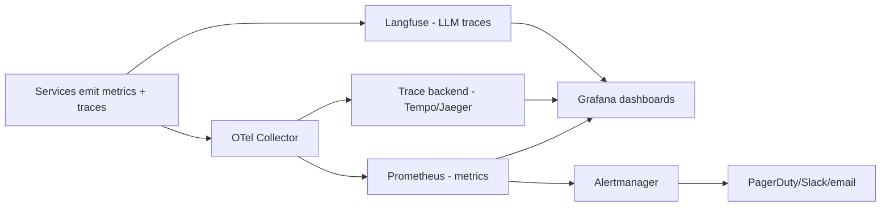
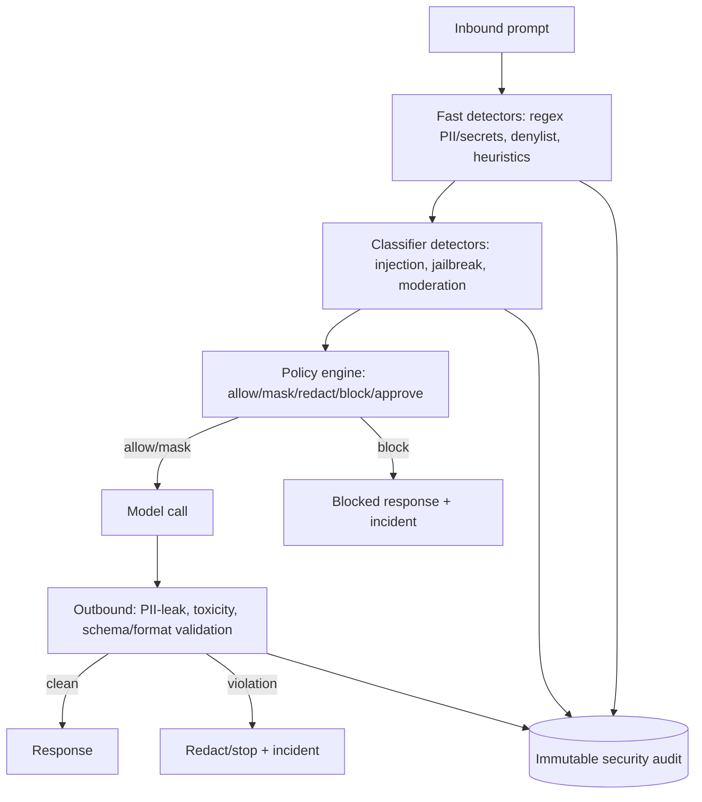
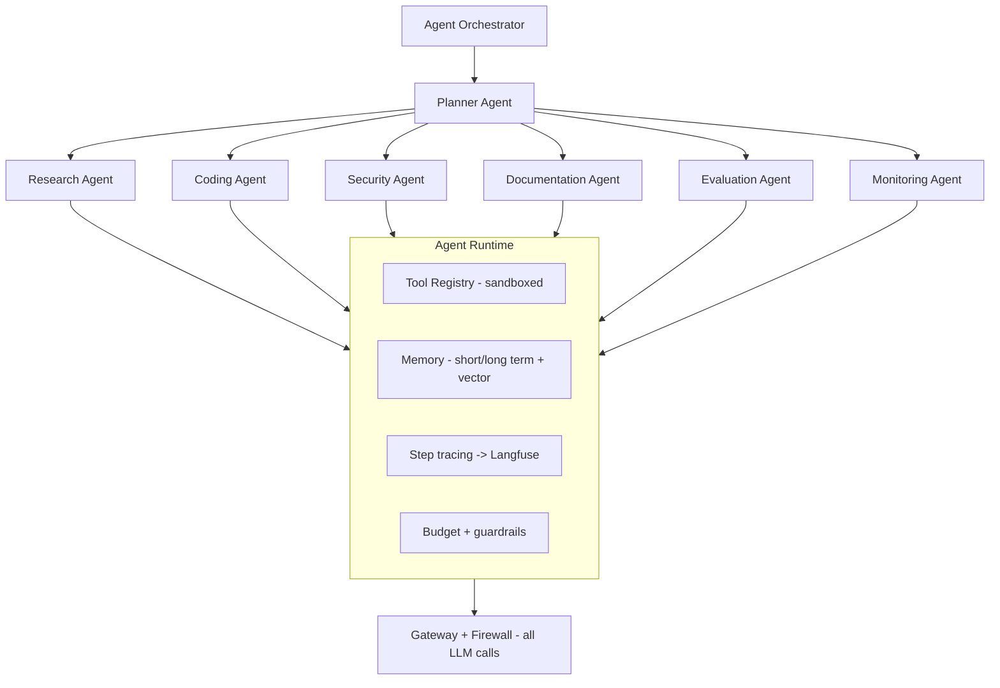
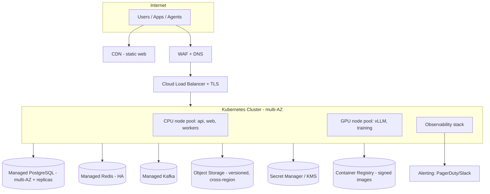

# SecurAI — Part 6: Deployment & Platform

> SAD Sections 25–33 — Deployment Architecture, Kubernetes Architecture, CI/CD Pipeline, Security Architecture, Monitoring Architecture, Logging Architecture, AI Safety Architecture, Agent Framework Design, Infrastructure Diagram.

---

## 25. Deployment Architecture

### 25.1 Environments

| Env | Purpose | Topology |
|---|---|---|
| **Local** | Dev / demo | Docker Compose (api, workers, web, pg, redis, kafka, vLLM optional, grafana). |
| **Staging** | Pre‑prod validation | Kubernetes (small node pools), real managed services. |
| **Production** | Live | Kubernetes (HA), managed PG/Redis/object store, GPU node pools. |

### 25.2 Packaging

- **Images:** separate, minimal images per concern — `api` (no torch), `workers`, `web` (static via nginx), `vllm` (CUDA + vLLM), `trainer` (CUDA + torch/peft). Multi‑stage builds, distroless/slim bases, non‑root, pinned digests.
- **Compose** profiles let a single engineer run the whole stack locally; GPU services optional behind a profile.
- **Helm** chart parameterizes replicas, resources, autoscaling, secrets, ingress, and per‑service toggles.
- **Terraform** provisions cloud infra (cluster, managed PG, Redis, object storage, registries, DNS, secrets).

### 25.3 Release strategy

Blue/green or canary for the control plane; rolling for stateless workers; **blue/green for vLLM** model deployments (warm new pods, shift traffic, drain old). One‑command rollback via Helm revision / image pin.

---

## 26. Kubernetes Architecture

### 26.1 Workload design

- **api/web/workers:** stateless `Deployment`s; **HPA** on CPU/RPS for api, **KEDA** on Kafka consumer lag for workers; PodDisruptionBudgets; topology spread; resource requests/limits.
- **vLLM:** GPU `Deployment` per model/adapter group; node selectors/taints for GPU pool; autoscale on GPU utilization/queue depth; readiness gates on model load.
- **training:** Kubernetes `Job`s on GPU pool, ephemeral, with checkpointing; queue‑driven.
- **Stateful backends:** prefer **managed** PG/Redis/Kafka/object store in cloud; Strimzi/operators or StatefulSets only where self‑managed.

### 26.2 Platform features

Namespaces per concern, NetworkPolicies (default‑deny + explicit allows), RBAC + ServiceAccounts (least privilege, IRSA/Workload Identity), secrets via External Secrets Operator → cloud secret manager, HPA/KEDA/Cluster Autoscaler, GPU device plugin, cert‑manager TLS, Ingress/Gateway API.

---

## 27. CI/CD Pipeline

### 27.1 GitHub Actions design

- **PR pipeline:** ruff/black, mypy, pytest (unit), import‑linter (boundaries), frontend lint/test/build, `pip-audit`/`npm audit`, secret scan (gitleaks), SAST (CodeQL/Bandit/Semgrep).
- **Main/merge:** integration + contract tests, build multi‑arch images, generate **SBOM**, **sign images** (cosign), push.
- **Deploy:** environment‑gated jobs; staging auto, prod with manual approval; Helm‑based; DB migrations as a pre‑deploy `Job`.
- **Caching/matrix:** layer caching, dependency caching, matrix per service.
- **GitOps option:** Argo CD/Flux watching an environments repo for declarative prod rollout.

### 27.2 Quality gates (block merge/deploy)

Coverage threshold on core modules, no high/critical vulns, type check clean, architectural boundary checks pass, migrations reversible, eval gate green for model changes.

---

## 28. Security Architecture

### 28.1 Defense in depth

### 28.2 Controls

- **Identity:** API keys hashed (Argon2id) + prefix lookup; OIDC + short‑lived JWT; MFA via IdP; key rotation & revocation.
- **Authorization:** RBAC scoped by org/project; mandatory `org_id` filtering; optional Postgres RLS.
- **Tenant isolation:** logical isolation by org; per‑tenant rate/quota; optional dedicated namespaces/keys for enterprise tier.
- **Secrets:** External Secrets Operator → cloud secret manager; never in env files/images; provider API keys encrypted (envelope encryption / KMS).
- **Data protection:** TLS everywhere; encryption at rest (DB, object store); field‑level encryption for provider credentials; PII redaction before persistence/logging.
- **Supply chain:** pinned deps, SBOM, signed images, image scanning, admission policy (only signed images), least‑privilege ServiceAccounts.
- **AI‑specific:** prompt firewall (see §31), output validation, agent sandboxing, tool allow‑lists, egress controls.
- **Compliance‑readiness:** audit trails, data‑residency hooks, retention policies, DSR (data subject request) tooling, SOC2‑aligned controls.
- **Threat model:** STRIDE per module; abuse cases for injection/exfiltration/key leakage/denial‑of‑wallet (cost abuse) with quotas and anomaly alerts.

---

## 29. Monitoring Architecture

### 29.1 Signals

- **Metrics (Prometheus):** RED (rate/errors/duration) per route; LLM metrics (TTFT, tokens/sec, tokens in/out, cost), cache hit rate, firewall block rate, router fallback rate, GPU utilization/memory, queue lag, training job status.
- **Traces (OTel → Tempo/Jaeger):** request spans across gateway→firewall→router→backend→workers, correlation IDs.
- **LLM traces (Langfuse):** prompt/response/cost/latency/feedback per call and per agent step.
- **Experiments (MLflow):** training params/metrics/artifacts.

### 29.2 SLOs & alerting

Defined SLOs (availability 99.9%, gateway p99 < 50 ms overhead, error rate < 1%); multi‑window burn‑rate alerts; alerts for safety spikes (injection/PII), cost anomalies (denial‑of‑wallet), GPU saturation, queue backlog, eval regressions. Dashboards per persona (SRE, Security, FinOps, ML).

---

## 30. Logging Architecture

- **Structured JSON logs** (`structlog`) with mandatory fields: `timestamp, level, service, request_id/trace_id, org_id, project_id, event, latency_ms`.
- **Correlation:** trace/request IDs propagated via context vars + OTel; logs join to traces.
- **Redaction:** PII/secret redaction at the logging boundary; prompts/responses logged only per project retention and access policy.
- **Pipeline:** stdout → cluster log agent (Fluent Bit/Vector) → log store (Loki/ELK/cloud logging) with index + retention tiers.
- **Audit logs:** separate, **append‑only**, tamper‑evident (hash‑chained) stream for security/compliance, longer retention.
- **Levels & sampling:** INFO default, DEBUG opt‑in per org/flag; high‑volume debug sampled.

---

## 31. AI Safety Architecture

### 31.1 Pipeline

- **Inbound:** layered detectors (fast → classifier → optional LLM judge), each producing structured findings with scores and rule ids.
- **Policy engine:** declarative rules per org/project decide action — `allow`, `mask` (PII/secrets), `redact`, `block`, or `require‑approval`. Modes: `monitor` (log only), `enforce`.
- **Outbound:** PII‑leak detection, toxicity, output schema/format validation; streaming‑safe (window buffering, hard‑stop on violation).
- **Auditability:** every decision → append‑only `security_events` + Kafka → dashboard + alerts. Decisions are **explainable**.

### 31.2 Safety principles

Safe by default, fail‑closed for high‑severity categories (configurable), versioned detectors with regression tests, red‑team test suite in CI, human‑in‑the‑loop for `require‑approval` flows, and continuous tuning to keep false positives < 2%.

---

## 32. Agent Framework Design

### 32.1 Design

- **Runtime:** typed agent loop (plan → act → observe), tool use, short/long‑term memory (vector‑backed), step tracing, retries, and **budget/guardrail enforcement** per run.
- **Orchestration:** a Planner decomposes goals and delegates to specialist agents; supports sequential and parallel sub‑tasks; results aggregated.
- **Specialist agents:** Planner, Research (retrieval/web/RAG), Coding, Security (analyzes for risks), Documentation, Evaluation (runs evals), Monitoring (watches metrics, raises incidents).
- **Hard rule — no bypass:** every agent LLM call routes through the **gateway + firewall**; tools are sandboxed with allow‑lists and egress controls; per‑agent token/cost budgets enforced.
- **Observability:** each step is a Langfuse span + OTel span; full run replayable; failures and budget breaches raise events.
- **Extensibility:** agents and tools are plugins behind stable interfaces; new agents added without core changes.

---

## 33. Infrastructure Diagram

- **Multi‑AZ** for HA; optional multi‑region for DR (see Part 7 §35).
- **Cloud‑agnostic:** the same Helm/Terraform abstractions target EKS/GKE/AKS with managed PG/Redis/object store equivalents.

---

*Continue to [Part 7 — Quality & Operations](./07-quality-and-operations.md).*
