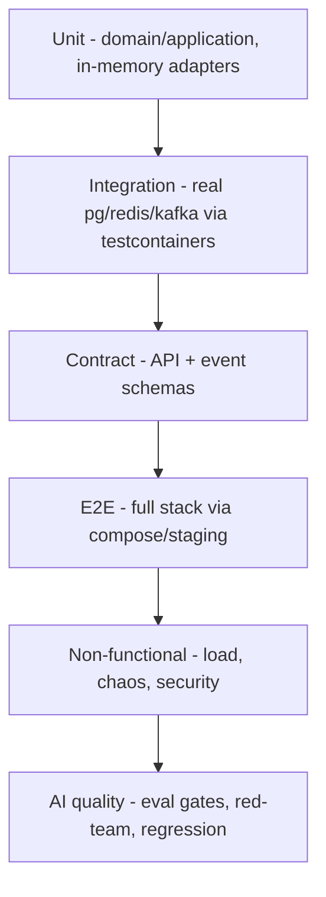

# SecurAI — Part 7: Quality & Operations

> SAD Sections 34–42 — Scaling Strategy, Disaster Recovery, Testing Strategy, Technology Decisions, Why Each Technology, Future Roadmap, Risks & Trade‑offs, Estimated Timeline, Recommended Implementation Order.

---

## 34. Scaling Strategy

| Layer | Scaling approach | Trigger |
|---|---|---|
| **Gateway/API** | Horizontal (stateless) behind LB; HPA. | CPU, RPS, p95 latency. |
| **Async workers** | Horizontal; KEDA. | Kafka consumer lag. |
| **vLLM inference** | Horizontal GPU pods; per‑model deployments; continuous batching maximizes per‑GPU throughput. | GPU utilization, queue depth. |
| **Training** | Job‑based, ephemeral GPU. | Queue length. |
| **PostgreSQL** | Vertical + **read replicas** for analytics; partitioning + connection pooling (PgBouncer). | Read load, table size. |
| **Redis** | Clustered/HA; eviction policies. | Memory, ops/sec. |
| **Kafka** | Add partitions/brokers; scale consumer groups. | Throughput, lag. |
| **Vector DB** | Sharding/replicas (Qdrant) or scale PG (pgvector). | Index size, QPS. |

### 34.1 Scaling principles

- **Stateless control plane** → trivial horizontal scale; all state in backing services.
- **Separate scaling domains** for CPU control plane vs GPU data plane.
- **Caching** (exact + semantic) and **prefix caching** reduce inference load.
- **Backpressure & load shedding** protect the system under saturation (429/503 + queue limits).
- **Cost‑aware autoscaling**: scale‑to‑zero for idle models, spot GPUs for training with checkpoint resume.
- **Data tiering**: hot in PG, warm aggregates in read models, cold logs/artifacts in object storage.

---

## 35. Disaster Recovery

### 35.1 Objectives

| Tier | RPO | RTO |
|---|---|---|
| Control data (PG) | ≤ 5 min | ≤ 30 min |
| Artifacts/audit (object store) | ~0 (versioned, cross‑region) | ≤ 30 min |
| Full region failover | ≤ 15 min | ≤ 1–2 h |

### 35.2 Mechanisms

- **PostgreSQL:** automated backups + **PITR**; cross‑AZ standby; periodic restore drills.
- **Object storage:** versioning + cross‑region replication for artifacts/datasets/audit.
- **Kafka:** replication factor ≥ 3; mirror to DR region if multi‑region.
- **IaC:** Terraform + Helm enable **rebuild‑from‑code** of an entire environment.
- **Backups tested:** scheduled restore verification; runbooks for region failover, DB restore, key rotation.
- **Graceful degradation:** if a region/provider is down, router fails over to healthy backends; firewall/gateway can run read‑only/limited mode.
- **Stateless services** redeploy instantly; no local state to recover.

---

## 36. Testing Strategy

| Layer | Scope | Tools |
|---|---|---|
| **Unit** | Domain + use cases, pure, fast (<60s). | pytest, hypothesis (property‑based). |
| **Integration** | Repos, cache, Kafka, migrations. | pytest + **testcontainers**. |
| **Contract** | API (OpenAPI) + event schemas; provider adapters (recorded). | schemathesis, pact‑style. |
| **E2E/smoke** | Critical user journeys. | playwright (web), httpx (api). |
| **Architecture** | Layer/boundary rules. | import‑linter. |
| **Load/perf** | Gateway latency/throughput SLOs. | k6/Locust. |
| **Chaos** | Backend failures, latency injection, pod kills. | fault injection, litmus. |
| **Security** | SAST, deps, secrets, DAST, **AI red‑team**. | CodeQL/Semgrep, gitleaks, jailbreak suite. |
| **AI quality** | Eval gates, hallucination/safety regression. | eval pipeline (§24). |

Principles: test the domain heavily (pure & fast), use real infra for integration, mock only at adapter boundaries, treat eval + red‑team as first‑class CI gates for AI changes.

---

## 37. Technology Decisions

| Concern | Choice | Alternatives considered |
|---|---|---|
| Language | Python 3.12 | Go/Node (rejected: ML ecosystem) |
| Web framework | FastAPI | Django/Flask, Litestar |
| Validation | Pydantic v2 | marshmallow |
| ORM/migrations | SQLAlchemy 2.0 + Alembic | Tortoise, raw SQL |
| DB | PostgreSQL (+ pgvector) | MySQL; separate vector db (Qdrant) optional |
| Cache | Redis | Memcached |
| Event bus | Kafka | RabbitMQ, NATS, Redpanda |
| Inference | vLLM | TGI, Ollama, Triton |
| Fine‑tuning | PyTorch + Transformers + PEFT + bitsandbytes | Axolotl/Unsloth (build on top) |
| Vector | pgvector (start) / Qdrant (scale) | Pinecone, Weaviate, Milvus |
| Workers | Celery / Arq | Dramatiq, Temporal (future) |
| Observability | Prometheus, Grafana, OpenTelemetry, Tempo/Jaeger | Datadog (cost) |
| LLM tracing | Langfuse | Phoenix, LangSmith |
| Experiments | MLflow | W&B (cost/OSS) |
| Frontend | React + TS + Vite + Tailwind | Next.js, Vue |
| Containers/orch | Docker + Kubernetes + Helm | Nomad, ECS |
| IaC | Terraform | Pulumi, CDK |
| CI/CD | GitHub Actions (+ optional Argo CD) | GitLab CI, Jenkins |
| Auth | API keys + OIDC/JWT | session cookies only |
| Secrets | External Secrets + cloud KMS | sealed‑secrets |

---

## 38. Why Each Technology Was Chosen

- **Python** — the only ecosystem with first‑class LLM tooling (Transformers, PEFT, vLLM), enabling one language across gateway, ML, and agents.
- **FastAPI** — async, high performance, Pydantic‑native, auto OpenAPI; ideal for an OpenAI‑compatible streaming gateway.
- **PostgreSQL** — ACID + JSONB + pgvector covers relational, flexible metadata, and vector search in one engine; reduces moving parts early.
- **Redis** — sub‑ms cache, rate limiting, idempotency, locks — the gateway's hot path needs.
- **Kafka** — durable, replayable event backbone for decoupled audit/billing/analytics/eval fan‑out; supports the event‑driven + extraction strategy.
- **vLLM** — best‑in‑class self‑hosted throughput (continuous batching, PagedAttention), OpenAI‑compatible, multi‑LoRA serving → cost‑efficient open‑model hosting.
- **PEFT/LoRA/QLoRA** — affordable fine‑tuning on commodity GPUs; many adapters per base model.
- **OpenTelemetry/Prometheus/Grafana** — vendor‑neutral, cloud‑agnostic observability standard.
- **Langfuse + MLflow** — purpose‑built LLM tracing and experiment tracking, both OSS/self‑hostable (no lock‑in).
- **Kubernetes + Helm + Terraform** — cloud‑agnostic, declarative, reproducible infra meeting HA/scaling/portability NFRs.
- **GitHub Actions** — native to the repo, strong ecosystem, supports gated multi‑env CD; Argo CD optional for GitOps.
- **React/TS/Vite/Tailwind** — fast, typed, productive SPA stack with generated API types for end‑to‑end safety.

Every choice favors **OSS + self‑hostable + cloud‑agnostic** to avoid lock‑in and support data‑residency/compliance.

---

## 39. Future Roadmap (post‑MVP capabilities)

- **Semantic caching v2** + prompt compression for further cost cuts.
- **Advanced routing:** learned routers (quality/cost prediction), token‑level cost optimization.
- **More providers:** Google Vertex, AWS Bedrock, Azure OpenAI, Cohere, local Ollama.
- **RAG platform module:** managed ingestion, chunking, retrieval, eval.
- **Guardrail marketplace:** pluggable third‑party detectors; policy templates per industry.
- **Multi‑region active/active; BYOC** (deploy in customer VPC).
- **Fine‑tuning:** DPO/ORPO preference tuning from collected feedback; distillation; serverless GPU.
- **Workflow engine** (Temporal) for durable agent/training orchestration.
- **Marketplace & billing:** usage‑based billing integration, budgets/alerts, chargeback.
- **Compliance:** SOC2/ISO27001 certification, HIPAA mode, audit export.

---

## 40. Risks & Trade‑offs

| Risk | Impact | Mitigation |
|---|---|---|
| **Scope too large for one engineer** | Stall / burnout | Strict phased roadmap; each phase shippable; defer non‑essential. |
| **Modular monolith erosion** (boundary leaks) | Hard future extraction | import‑linter gates, code review, ports‑only cross‑module calls. |
| **GPU cost/scarcity** | High spend, capacity limits | Multi‑LoRA, quantization, scale‑to‑zero, spot for training, caching, external fallback. |
| **Guardrail false positives/negatives** | UX harm / safety gaps | Layered detectors, monitor mode first, red‑team suite, tunable thresholds, human review. |
| **Latency budget vs. safety** | Slow requests | Fast path detectors inline; heavy detectors async/sampled. |
| **Denial‑of‑wallet (cost abuse)** | Runaway bills | Quotas, anomaly alerts, per‑key budgets, circuit breakers. |
| **Provider API drift** | Breakage | Adapter pattern + recorded contract tests; canonical schema. |
| **Data privacy/leak** | Compliance breach | Redaction, encryption, retention controls, output firewall, audit. |
| **Kafka/infra operational burden** | Ops overhead | Use managed services; introduce Kafka only when fan‑out justifies (Phase 2+). |
| **Vendor lock‑in** | Strategic risk | OSS, cloud‑agnostic abstractions, Terraform/Helm. |

### 40.1 Key trade‑offs (decisions & rationale)

- **Monolith vs microservices:** chose modular monolith for velocity + low latency, accepting future extraction cost (mitigated by boundaries).
- **pgvector vs dedicated vector DB:** start simple (pgvector), migrate to Qdrant at scale.
- **At‑least‑once events + idempotency:** simpler than exactly‑once, robust with dedupe.
- **Inline vs async guardrails:** split by latency class to balance safety and speed.

---

## 41. Estimated Development Effort (phased, by scope not calendar)

> Effort expressed as relative phase weight and the subsystems each phase touches, not calendar time. Phases are sequential and each is independently deployable.

| Phase | Relative effort | Subsystems touched | Exit demo |
|---|---|---|---|
| **P1 MVP — secure gateway** | Baseline (1.0×) | api(gateway+identity), one vLLM, dashboard shell, compose, basic logging/metrics, CI. | Authenticated OpenAI‑compatible call to a local model, logged, on Docker. |
| **P2 Intelligent routing** | ~0.8× | router, multi‑backend, cost/latency, retries/fallback, Redis cache, analytics read models. | Multi‑model routing with fallback + caching + cost view. |
| **P3 AI safety** | ~0.9× | firewall module, detectors, policy engine, audit, security console. | Injection/PII blocked & masked with audit + incident UI. |
| **P4 Eval & observability** | ~1.0× | evaluation module + workers, MLflow, Langfuse, OTel, Grafana, feedback, A/B. | Eval reports, traces, dashboards, A/B + feedback loop. |
| **P5 Fine‑tuning & deploy** | ~1.2× | finetune + registry, training workers, LoRA/QLoRA, K8s/Helm, Terraform, full CD. | Curate→train→eval→register→deploy on K8s via CI/CD. |
| **Agents (overlay)** | ~0.7× | agents module + runtime + specialist agents. | Multi‑agent workflow through gateway+firewall, traced. |

Risk‑adjust each phase with buffer for ML/infra unknowns (GPU, eval tuning, K8s).

---

## 42. Recommended Order of Implementation

1. **Foundation:** repo, monorepo layout, CI skeleton (lint/type/test), settings, DI container, base error/logging/otel, PG + migrations, identity module (orgs/users/projects/keys/RBAC).
2. **Gateway core:** OpenAI‑compatible endpoints, auth/RBAC middleware, validation, request logging, one vLLM backend, streaming, Docker Compose, basic dashboard (login, keys, request log).
3. **Routing & reliability:** backend registry, provider adapters (OpenAI/Anthropic), routing strategies, fallback/circuit breaker, retries, Redis cache (exact→semantic), cost/latency analytics.
4. **Safety:** firewall pipeline (fast→classifier detectors), policy engine, PII masking, output validation, append‑only audit, security console.
5. **Observability & eval:** OTel tracing, Prometheus/Grafana, Langfuse, MLflow, eval workers + scorers, feedback API, A/B, dashboards.
6. **Fine‑tuning & registry:** dataset curation, LoRA/QLoRA training workers, MLflow integration, model registry + lineage, promotion gate, deploy adapter to vLLM.
7. **Platform hardening:** Helm chart, K8s manifests, KEDA/HPA, Terraform, full CI/CD with environments, blue/green + rollback, DR runbooks.
8. **Agents:** agent runtime, specialist agents, budgets/guardrails, step tracing — built on the now‑mature gateway/firewall/eval foundation.

Cross‑cutting throughout: tests at each layer, security scans in CI, docs (ADRs + API), and event/outbox plumbing introduced when the first async consumer appears (Phase 2/3).

---

*Continue to [Part 8 — Process & Standards](./08-process-and-standards.md).*
