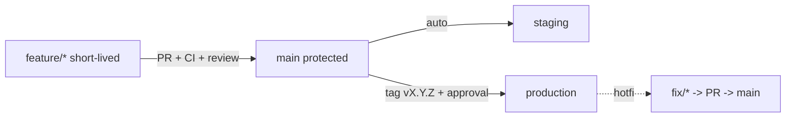
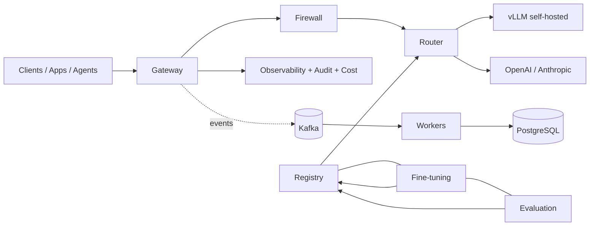

# SecurAI — Part 8: Process & Standards

> SAD Sections 43–50 — Git Branching Strategy, Code Quality Standards, Coding Conventions, Documentation Standards, API Documentation Strategy, Definition of Done, Production Deployment Checklist, Final Recommended Architecture.

---

## 43. Git Branching Strategy

**Trunk‑based with short‑lived feature branches** (optimized for a small team / single engineer with CI gates).

- **`main`** — always releasable; protected; every merge is green CI + reviewed.
- **Feature branches:** `feature/<scope>-<short-desc>`, `fix/...`, `chore/...`, `docs/...`. Short‑lived (merge fast, keep small).
- **PRs:** required checks (lint, type, tests, boundaries, security, build); squash‑merge to keep linear history.
- **Releases:** tag `vMAJOR.MINOR.PATCH` (SemVer) on `main`; release notes auto‑generated from conventional commits; optional `release/*` branch for hotfix backports if needed.
- **Environments:** `main` → auto‑deploy staging; tag/approval → production. (GitOps repo optional.)
- **Commits:** **Conventional Commits** (`feat:`, `fix:`, `docs:`, `refactor:`, `test:`, `chore:`) → drives changelog + SemVer.

---

## 44. Code Quality Standards

- **Type safety:** full type hints; `mypy --strict` on `domain`/`application`; TypeScript `strict` on frontend.
- **Linting/formatting:** `ruff` (lint + format) for Python; `eslint` + `prettier` for TS. Zero‑warning policy in CI.
- **Architecture enforcement:** `import-linter` contracts (domain imports nothing outward; modules talk only via ports/events).
- **Coverage:** ≥ 80% on core modules (domain/application); meaningful tests (no coverage‑gaming).
- **Complexity:** cyclomatic complexity & function length limits (ruff rules); small, focused functions.
- **Security:** Bandit/Semgrep SAST, `pip-audit`/`npm audit`, gitleaks — all blocking on high/critical.
- **Reviews:** ≥1 approval; PRs small (<~400 LOC ideal); author cannot self‑approve protected merges.
- **Pre‑commit hooks:** format, lint, type (fast subset), secret scan locally before push.
- **No TODO‑debt without tickets;** dead code removed; deprecations documented.

---

## 45. Coding Conventions

### 45.1 Python
- **Naming:** `snake_case` (functions/vars), `PascalCase` (classes), `UPPER_SNAKE` (constants), modules lowercase.
- **Structure:** one aggregate per module; ports as `Protocol`/ABC named `XxxRepo`/`XxxClient`; use cases as verbs (`CreateApiKey`, `RouteRequest`).
- **Errors:** custom domain exceptions; never raise bare `Exception`; map to problem+json at edge.
- **Async:** `async def` for IO; no blocking calls in event loop; offload CPU to pools.
- **Pydantic:** request/response/event schemas as models; domain entities are plain dataclasses (not Pydantic) to keep domain framework‑free.
- **Config:** via settings object; no `os.getenv` scattered in code.
- **Logging:** structured, no f‑string PII; use `logger.info("event", **fields)`.

### 45.2 TypeScript/React
- Function components + hooks; feature‑sliced structure; server state via TanStack Query; generated API types only (no hand‑written DTOs); accessibility required; no `any`.

### 45.3 General
- Conventional Commits; ADRs for significant decisions; descriptive names over comments; comments explain **why**, not **what**; 12‑factor config; immutability preferred.

---

## 46. Documentation Standards

| Doc type | Location | Standard |
|---|---|---|
| **Architecture (this SAD)** | `docs/architecture/` | Markdown + Mermaid; kept current with changes. |
| **ADRs** | `docs/adr/NNNN-title.md` | MADR format: context, decision, status, consequences. |
| **Module READMEs** | `apps/api/src/securai/modules/<m>/README.md` | Purpose, boundaries, ports, events, ownership. |
| **Runbooks** | `docs/runbooks/` | On‑call procedures: DR, rotation, incident, scaling. |
| **API reference** | auto‑generated (see §47) | OpenAPI; published. |
| **Changelog** | `CHANGELOG.md` | Generated from conventional commits. |
| **Onboarding** | `README.md` + `docs/dev/` | Local setup, make targets, contribution guide. |

Principles: docs live with code, reviewed in the same PR as code changes; diagrams as code (Mermaid) so they're versioned; "if it isn't documented, it isn't done".

---

## 47. API Documentation Strategy

- **Source of truth:** FastAPI + Pydantic generate **OpenAPI 3.1** automatically; served at `/docs` (Swagger UI) and `/redoc`.
- **Contract‑first ergonomics:** OpenAPI exported in CI as an artifact; frontend & SDK types generated from it (`openapi-typescript`, `openapi-python-client`) → drift‑proof.
- **Versioning:** URL‑versioned (`/v1`, `/api/v1`); breaking changes → new version + deprecation policy + sunset headers.
- **Events:** documented via **AsyncAPI** spec for Kafka topics/schemas.
- **Examples:** every endpoint has request/response examples and error (problem+json) docs.
- **OpenAI compatibility note:** the inference API documents its compatibility surface and any extensions explicitly.
- **Published portal:** API docs deployed (static) alongside the dashboard; SDK quickstarts included.

---

## 48. Definition of Done (per module)

A module/feature is **Done** only when **all** of the following hold:

1. **Functional:** meets acceptance criteria of its user stories; feature‑flagged if partial.
2. **Architecture:** respects layer/boundary rules (import‑linter green); cross‑module access via ports/events only.
3. **Tests:** unit + integration written and passing; ≥80% core coverage; contract tests for any API/event; critical path E2E.
4. **Quality:** lint/format/type checks clean; complexity within limits; reviewed & approved.
5. **Security:** SAST/deps/secret scans clean; authz enforced; inputs validated; PII handled; threat cases covered.
6. **Observability:** metrics, traces, structured logs, and (for LLM paths) Langfuse traces emitted; dashboards/alerts updated.
7. **Data:** migrations written, reversible, and applied in CI; retention/redaction respected.
8. **Docs:** module README, ADRs for decisions, API/event docs, runbook updates.
9. **Ops:** Helm/compose values, resource requests/limits, health probes, autoscaling config present.
10. **Demo:** works end‑to‑end in staging; rollback path verified.

---

## 49. Production Deployment Checklist

**Pre‑deploy**
- [ ] CI green: lint, type, unit, integration, contract, boundary, security scans.
- [ ] Images built, scanned, **signed** (cosign); SBOM generated; pinned digests.
- [ ] DB migrations reviewed, reversible, dry‑run on staging; backup taken.
- [ ] Config/secrets present in target env (External Secrets synced); no plaintext secrets.
- [ ] Feature flags set correctly; canary plan defined.
- [ ] Dashboards & alerts updated; SLOs defined; runbook ready.
- [ ] Capacity check (GPU/CPU/quota); autoscaling configured.

**Deploy**
- [ ] Run migration Job.
- [ ] Canary (small %), verify metrics/traces/errors within SLO.
- [ ] Progressive rollout; vLLM via blue/green with warm‑up.
- [ ] Verify health/readiness; smoke tests pass.

**Post‑deploy**
- [ ] Monitor error rate, latency, cost, safety, GPU for the burn‑in window.
- [ ] Confirm logs/traces/audit flowing; eval gate (for model changes) green.
- [ ] Rollback rehearsed & one command away (Helm revision / image pin).
- [ ] Announce + update changelog; close deployment ticket.

**Security/compliance**
- [ ] TLS valid; NetworkPolicies enforced; least‑privilege SAs; audit logging on; data residency respected.

---

## 50. Final Recommended Architecture

### 50.1 Recommendation

Build **SecurAI as a microservice‑ready modular monolith** for the control plane (FastAPI, hexagonal modules, DI, repository pattern, CQRS where it pays, transactional outbox + Kafka events), with **GPU/data‑plane concerns (vLLM inference, LoRA/QLoRA training, async workers) deployed as separate services from day one**. Persist control data in **PostgreSQL (+pgvector)**, use **Redis** for the hot path, **Kafka** for durable event fan‑out, and **object storage** for artifacts. Wrap everything in **OSS, cloud‑agnostic observability** (Prometheus/Grafana/OTel/Langfuse/MLflow) and ship via **Docker → Kubernetes/Helm → Terraform** with **GitHub Actions** gated CI/CD.

### 50.2 Why this is the right architecture

- **Buildable by one engineer in phases** — single deployable + clear roadmap; each phase is demoable and production‑ready.
- **Enterprise‑grade** — HA, security‑in‑depth, full observability, audited safety, compliance‑ready.
- **Low latency** — in‑process module calls on the request hot path; network hops only where scaling demands (GPU/training/async).
- **Extensible** — providers, detectors, routers, scorers, agents are plugins behind stable ports.
- **Future‑proof** — bounded contexts + ports + events make microservice extraction mechanical when scale or org structure demands it.
- **No lock‑in** — OSS + Terraform/Helm abstractions run on AWS/GCP/Azure or on‑prem.

### 50.3 The one‑paragraph mental model

> *Every AI request enters through one OpenAI‑compatible gateway, is authenticated and rate‑limited, screened by a prompt firewall, routed by cost/latency/quality/GPU policy to a self‑hosted vLLM model or an external provider (with automatic fallback), screened again on the way out, and fully accounted for (cost, tokens, traces, audit) — while a registry, fine‑tuning pipeline, evaluation system, agent runtime, and dashboard turn that single governed pathway into a complete LLMOps/AgentOps/AI‑Security platform.*

### 50.4 Architecture at a glance

---

*End of the SecurAI Software Architecture Document. See [index](./README.md) for navigation.*
